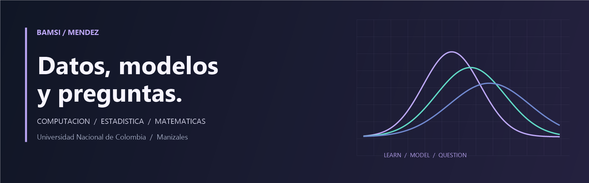

  

  <a href="https://www.linkedin.com/in/bamsimendez">LinkedIn</a> ·
  <a href="https://www.kaggle.com/bamsimendez">Kaggle</a> ·
  <a href="https://github.com/BamsiMendez?tab=repositories">Repositories</a> ·
  <a href="README.md">Español</a>

## Hi, I'm Bamsi 👋

I'm a **Computer Science student at Universidad Nacional de Colombia, Manizales campus**. I'm interested in connecting machine learning, statistics and mathematics to understand phenomena, estimate parameters and quantify what we still don't know.

I enjoy the whole process: asking a question, building a model, implementing it and examining its results. This profile brings together my academic projects, experiments and ongoing learning.

### What I'm exploring

- **Scientific machine learning:** physics-informed neural networks (PINNs), inverse problems and comparisons with classical methods.
- **Statistical inference:** Bayesian models, parameter estimation, identifiability and uncertainty.
- **Foundations:** probability, analysis and numerical methods.

### Selected projects

#### 01 · PINNs and parameter inference in cell dynamics

What can FUCCI cell observations tell us about the parameters of a reaction-diffusion model? A project with **Sergio Arias**, presented at the **Second Statistics Workshop (2026)**, comparing classical parameter estimation with PINNs and examining identifiability, uncertainty and residual diagnostics.

**Tools and concepts:** Python · differential equations · optimization · Gaussian observation model · inverse problems.

[Explore the repository →](https://github.com/BamsiMendez/poster-PINNs)

#### 02 · Bayesian analysis of crime in Chicago

Presented at the **35th International Symposium on Statistics (2026)**. Combines crime records and socioeconomic indicators across **Chicago's 77 community areas** to study crime counts and arrests using probabilistic models.

**Tools and concepts:** Python · Stan / CmdStanPy · binomial and negative binomial models · HMC/NUTS · posterior diagnostics · PSIS-LOO.

### Tools I work with

| Area | Tools and methods |
| :--- | :--- |
| Data and scientific computing | Python, NumPy, pandas, Polars, SciPy, Jupyter |
| Machine learning | scikit-learn, PyTorch |
| Bayesian modeling | Stan / CmdStanPy, PyMC, ArviZ |
| Programming | Python, Java, C++ |
| Writing and collaboration | LaTeX, Git, GitHub, Google Colab |

### Beyond code

I also work as a programming teaching assistant and enjoy explaining ideas as I learn them. Away from the computer, I train **Brazilian jiu-jitsu and judo**, play chess and study Portuguese. I'm interested in opportunities to learn and do research with others, especially where statistics meets machine learning.

For conversations about related projects, find me on [LinkedIn](https://www.linkedin.com/in/bamsimendez).

---

Manizales, Colombia · Computer science, statistics and curiosity.
