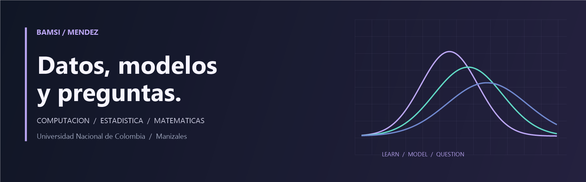

  

  <a href="https://www.linkedin.com/in/bamsimendez">LinkedIn</a> ·
  <a href="https://www.kaggle.com/bamsimendez">Kaggle</a> ·
  <a href="https://github.com/BamsiMendez?tab=repositories">Repositorios</a> ·
  <a href="README.en.md">English</a>

## Hola, soy Bamsi 👋

Estudio **Ciencias de la Computación en la Universidad Nacional de Colombia, sede Manizales**. Me interesa conectar el aprendizaje automático con la estadística y las matemáticas para entender fenómenos, estimar parámetros y cuantificar lo que todavía no sabemos.

Disfruto el recorrido completo: formular una pregunta, construir un modelo, programarlo y examinar sus resultados. Aquí comparto proyectos académicos, experimentos y el trabajo que voy desarrollando en ese camino.

### En qué estoy trabajando

- **Aprendizaje científico:** redes neuronales informadas por la física (PINNs), problemas inversos y su comparación con métodos clásicos.
- **Inferencia estadística:** modelos bayesianos, estimación de parámetros, identificabilidad e incertidumbre.
- **Fundamentos:** seguir profundizando en probabilidad, análisis y métodos numéricos.

### Proyectos seleccionados

#### 01 · PINNs e inferencia de parámetros en dinámica celular

¿Qué podemos aprender sobre los parámetros de un modelo de reacción-difusión a partir de observaciones celulares FUCCI? Proyecto con **Sergio Arias**, presentado en el **Segundo Workshop de Estadística (2026)**, que compara un enfoque clásico de estimación con PINNs y estudia identificabilidad, incertidumbre y diagnóstico de residuos.

**Herramientas y conceptos:** Python · ecuaciones diferenciales · optimización · modelo de observación gaussiano · problemas inversos.

[Explorar el repositorio →](https://github.com/BamsiMendez/poster-PINNs)

#### 02 · Análisis bayesiano de criminalidad en Chicago

Proyecto presentado en el **35.º Simposio Internacional de Estadística (2026)**. Integra registros de delitos con indicadores socioeconómicos de las **77 áreas comunitarias de Chicago** para estudiar conteos y arrestos mediante modelos probabilísticos.

**Herramientas y conceptos:** Python · Stan / CmdStanPy · modelos binomiales y binomiales negativos · HMC/NUTS · diagnóstico posterior · PSIS-LOO.

### Con qué trabajo

| Área | Herramientas y métodos |
| :--- | :--- |
| Datos y computación científica | Python, NumPy, pandas, Polars, SciPy, Jupyter |
| Aprendizaje automático | scikit-learn, PyTorch |
| Modelado bayesiano | Stan / CmdStanPy, PyMC, ArviZ |
| Programación | Python, Java, C++ |
| Escritura y colaboración | LaTeX, Git, GitHub, Google Colab |

### Un poco más de mí

También soy monitor de programación y me gusta explicar las ideas que voy aprendiendo. Fuera del computador, entreno **jiu-jitsu brasileño y judo**, juego ajedrez y estudio portugués. Me entusiasma encontrar espacios para investigar y aprender con otras personas, especialmente en la intersección entre estadística y aprendizaje automático.

Si trabajas en temas cercanos o quieres conversar sobre un proyecto, puedes encontrarme en [LinkedIn](https://www.linkedin.com/in/bamsimendez) o escribirme un [correo](mailto:bamendezp@unal.edu.co).

---

Manizales, Colombia · Computación, estadística y curiosidad.

